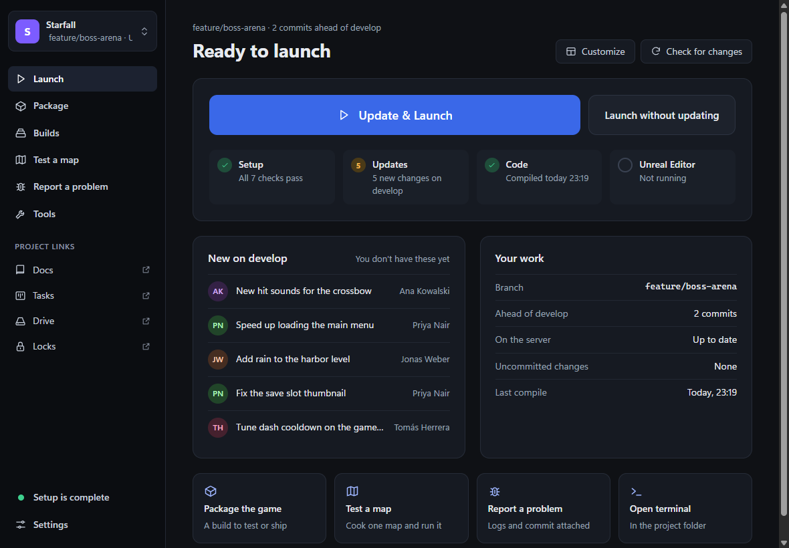

# UE Dev Hub

A desktop hub for Unreal Engine projects that use Git and Git LFS, on Windows and Linux.

It assumes the feature branch workflow: everyone works on their own branch and keeps it up to date with a
shared base branch. Each project chooses whether branches are brought up to date by merging or by
rebasing.



- **Launch**: gets the team's latest changes into your branch, compiles and opens the editor.
- **Package** a build for the team or for players, with an optional lighting bake, a zip and an upload
  to Nextcloud. **Builds** lists them, ready to play.
- **Test a map**: cook one map and run it.
- **Report a problem** to a Discord channel, with logs, screenshots and the exact commit.
- **Tools**: terminal, IDE, lighting bake, dependencies and fixes for common problems.
- **Setup**: everything the computer needs, each with a way to fix it.

It can switch between several projects, and it updates itself. Projects that use Wwise also get
soundbank generation; for everyone else it doesn't show up.

## Installing

Download it from [Releases](https://github.com/chillpert/ue-dev-hub/releases/latest), or let a
project's `Launch.sh` fetch it (see below).

**Windows**

- `UE-Dev-Hub_<version>_x64-setup.exe` installs it for your user to `%LOCALAPPDATA%\UE Dev Hub`, with a
  Start menu entry and an uninstaller. Installed copies update themselves.
- `ue-dev-hub.exe` runs without installing. `Launch.sh` keeps this copy in
  `%LOCALAPPDATA%\UE Dev Hub Portable`, and it also updates itself.
- The files aren't Authenticode-signed, so SmartScreen may warn the first time. Click **More info >
  Run anyway**. Updates are signed with the hub's own key and checked before they're used.

**Linux**

- The AppImage: `chmod +x UE-Dev-Hub_*.AppImage` and run it. It needs FUSE 2 (`libfuse2`); without it,
  run it with `APPIMAGE_EXTRACT_AND_RUN=1`. It updates itself. `Launch.sh` keeps it in
  `~/.local/share/ue-dev-hub/ue-dev-hub.AppImage`.
- The .deb: `sudo apt install ./UE-Dev-Hub_*.deb`. It doesn't update itself; install the next
  release's .deb the same way.

**Where it keeps its files**

| | Windows | Linux |
|---|---|---|
| Settings, upload state | `%APPDATA%\com.chillpert.uedevhub` | `~/.config/com.chillpert.uedevhub` |
| Add-ons | `%LOCALAPPDATA%\com.chillpert.uedevhub\addons` | `~/.local/share/com.chillpert.uedevhub/addons` |
| `hub.log` | `%LOCALAPPDATA%\com.chillpert.uedevhub\logs` | `~/.local/share/com.chillpert.uedevhub/logs` |
| Nextcloud logins | Windows Credential Manager | the desktop keyring (Secret Service) |

Logs of builds, packaging and test runs go to the project's `Saved/Logs`.

## Platform support

Both platforms get the same screens, with these differences:

- The Visual Studio and Wwise checks in Setup, and soundbank generation, are Windows-only. Packaging on
  Linux uses the soundbanks already in the project.
- On Linux, the engine is a source build or Epic's Linux zip. The hub finds engines registered in
  `~/.config/Epic/UnrealEngine/Install.ini` (a source build registers itself when you first run it), or
  you pick the folder by hand.
- Linux needs `git`, `git-lfs`, `unzip` and `zip`, WebKitGTK 4.1 (`libwebkit2gtk-4.1-0`),
  `libayatana-appindicator3-1` for the tray icon, and a Secret Service keyring (GNOME Keyring, KWallet)
  to remember Nextcloud logins. Releases are built on Ubuntu 22.04, so they need glibc 2.35 or newer.

## Adding it to a project

1. Copy [`examples/Launch.sh`](examples/Launch.sh) into the project root, next to the `.uproject`.
   On Windows it runs through Git Bash.
2. Optionally add a `ue-dev-hub.toml` (see below). The hub's Setup screen can create one.
3. Everyone opens the project with `Launch.sh`.

`Launch.sh` uses the installed hub if there is one. Otherwise it downloads the hub and runs it
without installing: to `%LOCALAPPDATA%\UE Dev Hub Portable` on Windows, as an AppImage on Linux. On
Windows the hub then offers to install itself, which adds a Start menu entry and lets you uninstall
it like any app.

If you add `Launch.sh` from Windows, keep it executable and with Unix line endings, or it won't run on
Linux:

```sh
git add --chmod=+x Launch.sh
echo '*.sh text eol=lf' >> .gitattributes
```

The first download through `Launch.sh` is plain HTTPS from GitHub and isn't signature-checked; every
update after that is. To check a download by hand, compare it with the release's `SHA256SUMS`
(`sha256sum ue-dev-hub.AppImage`, or `Get-FileHash ue-dev-hub.exe` in PowerShell).

## Project settings

A `ue-dev-hub.toml` in the project root holds the team's settings. Everything is optional, and Setup
points out mistakes. Personal overrides go in a gitignored `ue-dev-hub.local.toml`.

```toml
min_hub_version = "0.2.0"     # older hubs warn that they need to update

[project]
display_name = "Starfall"
base_branch = "main"               # default: origin's default branch
engine_version = "5.8"             # default: the .uproject's EngineAssociation; or a source build's {GUID}

[git]
update = "merge"                   # or "rebase", which needs a force push
push = "ask"                       # or "always", "never"
branch_prefixes = ["feat", "fix"]  # kinds offered for new branches (feat/my-work); default: any name

[requirements]
visual_studio = "2022"
wwise = "2024.1.0.1234"            # only for projects that use Wwise

[[links]]                          # shown in the sidebar
label = "Docs"
url = "https://docs.example.com"
icon = "docs"                      # docs, tasks, drive, lock, chat or link

[package]
lighting_quality = "Medium"
maps = ["/Game/Maps/Menu", "/Game/Maps/Level_P"]  # default: +MapsToCook= in Config/DefaultGame.ini
wwise_project = "Audio/Starfall.wproj"  # default: <Name>_WwiseProject/<Name>_WwiseProject.wproj
soundbanks = true                  # whether "Generate soundbanks" starts ticked
zip = true                         # whether "Zip it" starts ticked; uploading needs the zip

[test_map]
main_level_suffix = "_P"           # maps ending in this are listed as main levels

[report]
discord_webhook = "https://discord.com/api/webhooks/..."

[upload]
nextcloud_url = "https://cloud.example.com"
folder = "Team/Builds/{year}"         # {year} and {month} are filled in
```

Setup's template lists every option. Anyone who can read the repository can post with the Discord
webhook, so keep it in a private repository or in each person's `ue-dev-hub.local.toml`.

## Addons

Addons add pages to the hub, like the Git page. Each person turns them on or off per project
in Settings > Addons, where they can also install official addons or one from a zip or folder.
A project can turn addons on for everyone:

```toml
[addons]
default = ["git"]
```

Official addons that a project lists install by themselves, signed and checked; anyone can still
turn one off for themselves. How addons are made, and the API they use, is in
[docs/addons.md](docs/addons.md).

## Trust and privacy

- **A project runs its own code.** Opening, building or packaging a project runs Unreal's build tools
  and the editor, which run the project's build scripts and modules. A `git_hooks_path` in the
  project's settings makes Git run the project's hooks. Only open projects you'd run anyway.
- **Addons are fully trusted.** An addon's helper runs as you, with your files and network. Official
  addons are signed and checked; an addon installed from a zip or folder isn't, so only install ones
  you trust.
- **Avatars.** To show who made new commits, the hub asks GitHub for a profile picture for each
  commit author's email address (`avatars.githubusercontent.com`). GitHub sees those addresses and
  your IP address. Authors without a picture get their initials.
- Otherwise the hub talks to GitHub for its own updates and the official addons, and to what
  the project sets up: its Git server, Discord webhook, Nextcloud, and for `[[dependencies]]`, rclone's
  download site and the rclone remotes.

## Development

Requires Rust (the version in `rust-toolchain.toml`), Node.js and the
[Tauri prerequisites](https://tauri.app/start/prerequisites/).

```sh
npm install
npm run tauri dev            # run with hot reload
cd src-tauri && cargo test   # the Git tests use throwaway repositories
```

CI builds and tests pull requests and `main` on Windows and Linux. See
[CONTRIBUTING.md](CONTRIBUTING.md).

## Releasing

Bump the version in `src-tauri/tauri.conf.json`, `src-tauri/Cargo.toml` and `package.json` (and run
`cargo check` so `Cargo.lock` follows), then push a tag like `v0.2.0`. The release workflow builds,
signs and publishes the Windows installer and portable exe, the Linux AppImage and .deb, `latest.json`
for the updater and `SHA256SUMS`. The release stays a draft until every file is uploaded.

It needs the secrets `TAURI_SIGNING_PRIVATE_KEY` (the content of the updater's private key file) and
`TAURI_SIGNING_PRIVATE_KEY_PASSWORD` (if the key has one). Keep them in a GitHub environment named
`release` that only `v*` tags may use. The releases must be public for downloads and updates to work.

To try a release without publishing one, run the Release workflow by hand from the Actions tab. That
dry run builds both platforms, signs them with a throwaway key, checks the signatures and writes
`latest.json`, and keeps it all as a workflow artifact named `release`.

## License

[MIT](LICENSE)
